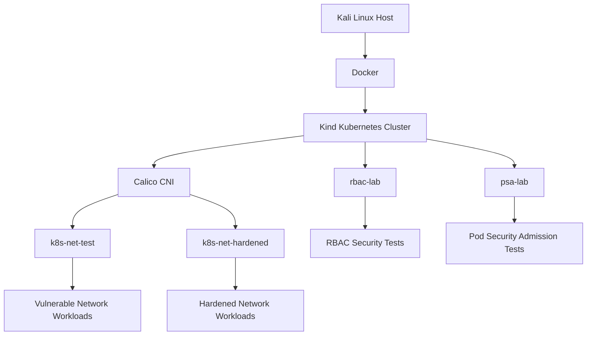

# Kubernetes Security: Vulnerability Assessment and Hardening

A hands-on Kubernetes security project focused on identifying common Kubernetes misconfigurations, testing security weaknesses in an isolated lab, and implementing security controls using Kubernetes, Kind, and Calico.

## Project Overview

This project explores practical Kubernetes security through controlled vulnerability assessments and security hardening exercises.

It uses an isolated Kubernetes cluster to demonstrate how insecure configurations can expose workloads and cluster resources, and how security mechanisms can reduce those risks.

The project currently covers:

- Kubernetes cluster setup using Kind.
- Network isolation using Calico NetworkPolicies.
- Role-Based Access Control (RBAC) and least-privilege permissions.
- Pod Security Admission (PSA).
- Container security-context hardening.
- Vulnerable-versus-hardened workload testing.

## Project Objectives

1. Build an isolated Kubernetes security testing environment.
2. Demonstrate network-level workload isolation.
3. Identify and test excessive Kubernetes permissions.
4. Apply least-privilege RBAC policies.
5. Assess insecure pod configurations.
6. Enforce Kubernetes Pod Security Standards.
7. Harden application workloads and validate security controls.
8. Extend the project with security monitoring and detection.

## Technology Stack

| Technology | Purpose |
|---|---|
| Kali Linux | Security testing environment |
| Kubernetes | Container orchestration |
| Kind | Local Kubernetes cluster |
| Docker | Container runtime |
| kubectl | Kubernetes administration |
| Calico | Container networking and NetworkPolicies |
| YAML | Kubernetes resource configuration |
| Git and GitHub | Version control and project hosting |

## Project Architecture

The project uses a local Kind cluster with a Calico CNI.

The security experiments use separate namespaces to isolate test scenarios and preserve the original vulnerable baseline.



## Project Milestones

### M1 – Kubernetes Environment Setup

**Status: Completed**

- Installed and configured Docker and Kubernetes tooling.
- Created a local Kind cluster.
- Configured Calico as the cluster networking provider.
- Verified node readiness and essential Kubernetes system components.

Configuration files:

- `kind-config.yaml`
- `kind-calico-config.yaml`

### M2 – Kubernetes Network Security

**Status: Completed**

Implemented network isolation using Calico NetworkPolicies.

Experiments included:

- Deploying client and server workloads.
- Creating a Kubernetes ClusterIP Service.
- Applying a default-deny ingress policy.
- Allowing traffic only from an authorized client.
- Testing authorized and unauthorized connectivity.

The authorized client successfully accessed the server, while the unauthorized client was blocked.

Original baseline namespace: `k8s-net-test`.

### M3 – Role-Based Access Control (RBAC)

**Status: Completed**

Evaluated Kubernetes permissions and demonstrated the risks of excessive privileges.

Experiments included:

- Creating ServiceAccounts, Roles, and RoleBindings.
- Testing least-privilege pod-reader permissions.
- Creating a controlled overprivileged RBAC scenario.
- Testing access to pods, secrets, deployments, and cluster resources.
- Removing the dangerous cluster-admin binding.
- Applying and validating least-privilege permissions.

Key result:

The hardened ServiceAccounts could read pods within their authorized namespace but could not access secrets or perform unauthorized operations.

### M4 – Vulnerability Assessment and Workload Hardening

**Status: Completed**

Tested insecure pod configurations and implemented security controls.

Security mechanisms implemented:

- Kubernetes Pod Security Admission.
- Baseline and Restricted Pod Security Standards.
- Non-root container execution.
- Disabled privilege escalation.
- Read-only root filesystem.
- Dropped Linux capabilities.
- RuntimeDefault seccomp profile.
- Disabled automatic ServiceAccount token mounting.

Runtime validation confirmed:

| Security test | Hardened result |
|---|---|
| Container user | UID 1000 |
| Effective Linux capabilities | All dropped |
| ServiceAccount token | Not mounted |
| Root filesystem | Read-only |
| Authorized network access | Allowed |
| Unauthorized network access | Blocked |

The original network test environment was preserved in `k8s-net-test`, while hardened workloads were deployed separately in `k8s-net-hardened`.

## Repository Structure

```text
k8s-security-fyp/
│
├── hardened/
│   ├── k8s-net-hardened-networking.yaml
│   ├── k8s-net-hardened-workloads.yaml
│   ├── least-privilege-rbac.yaml
│   ├── psa-secure-pod.yaml
│   └── secure-pod.yaml
│
├── vulnerable/
│   ├── insecure-pod.yaml
│   ├── overprivileged-rbac.yaml
│   ├── psa-privileged-pod.yaml
│   └── psa-restricted-test.yaml
│
├── reports/
│   ├── network-workload-hardening-20261110.md
│   ├── psa-security-assessment-20261110.md
│   ├── rbac-overprivilege-comparison-20261110.md
│   ├── pod-security-assessment.md
│   └── rbac-assessment-summary.md
│
├── attack-scripts/
├── backups/
├── docs/
├── falco/
├── screenshots/
│
├── kind-config.yaml
├── kind-calico-config.yaml
├── rbac-pod-reader.yaml
├── rbac-pod-reader-binding.yaml
├── .gitignore
└── README.md
```

## Environment Requirements

- Kali Linux or another compatible Linux distribution.
- Docker.
- Kind.
- kubectl.
- Calico CNI.
- Basic knowledge of Linux, containers, Kubernetes, and YAML.

The current lab was tested using Kubernetes v1.34.0 in a Kind cluster.

## Getting Started

Clone the repository:

```bash
git clone https://github.com/Softpaws-3104/k8s-security-fyp.git
cd k8s-security-fyp
```

Create the Kind cluster using the Calico configuration:

```bash
kind create cluster --config kind-calico-config.yaml
```

Install and configure Calico according to the compatible Calico installation instructions before deploying the network-security experiments.

Verify the cluster:

```bash
kubectl get nodes
kubectl get pods -A
```

The commands below demonstrate how to inspect the existing experiment configurations. Apply them only in an appropriately prepared lab environment.

Inspect hardened workloads:

```bash
kubectl get pods -n k8s-net-hardened
kubectl get networkpolicies -n k8s-net-hardened
```

Inspect RBAC:

```bash
kubectl get roles,rolebindings -n rbac-lab
```

Inspect Pod Security Admission:

```bash
kubectl get namespace psa-lab --show-labels
kubectl get pods -n psa-lab
```

## Security Reports

Detailed experiment results are available in the `reports/` directory.

These reports document:

- Vulnerable and hardened pod comparisons.
- RBAC overprivilege testing.
- Pod Security Admission enforcement.
- Network workload hardening.
- Runtime security verification.

## Future Scope

The next planned development phase is security monitoring and detection.

Potential extensions include:

- Falco-based runtime threat detection.
- Monitoring suspicious container activity.
- Detecting unauthorized Kubernetes API operations.
- Security alert generation.
- Attack simulation and detection validation.
- Centralized security reporting.

These features are planned extensions and are not currently claimed as completed.

## Security Disclaimer

This repository contains intentionally vulnerable Kubernetes manifests for educational security testing.

Use vulnerable configurations only in an isolated, authorized laboratory environment.

Do not deploy the vulnerable manifests in production or on publicly accessible clusters.

The project is intended for learning, research, security assessment, and defensive Kubernetes hardening.

## Author

**Madhur Kanoje**

B.Tech – Computer Science and Engineering

GitHub: [Softpaws-3104](https://github.com/Softpaws-3104)

---

**Project status:** M1–M4 completed. Security monitoring and detection are planned for the next development phase.
