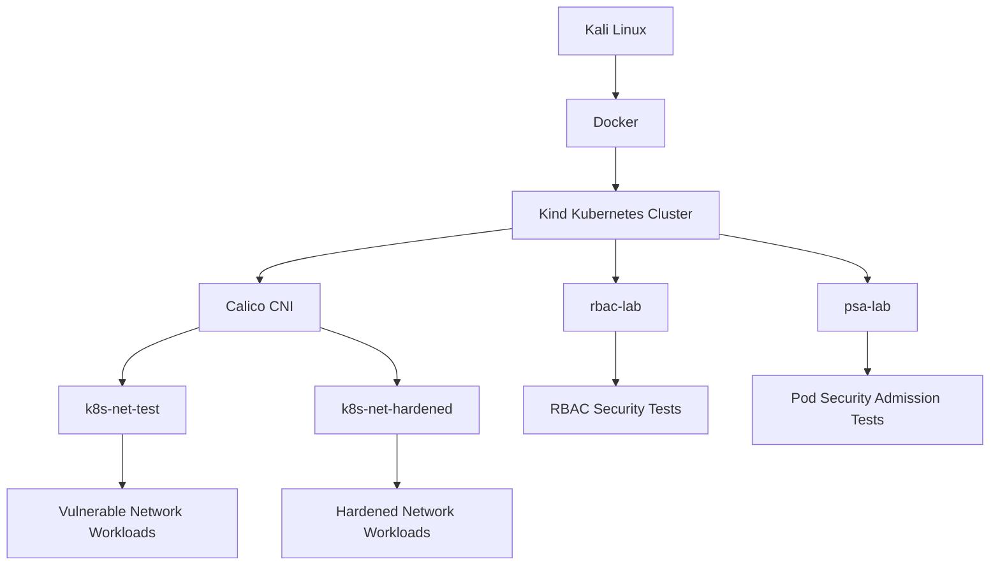

# Kubernetes Security: Vulnerability Assessment and Hardening

A hands-on Kubernetes security project focused on identifying Kubernetes misconfigurations, testing vulnerabilities in an isolated laboratory, and implementing defensive security controls.

## Project Overview

This project demonstrates practical Kubernetes security using Kali Linux, Kubernetes, Kind, Docker, and Calico.

The primary goal is to understand common Kubernetes security risks through controlled experiments and implement appropriate security mechanisms to protect workloads and cluster resources.

### Project Objectives

- Build an isolated Kubernetes security testing environment.
- Implement network isolation using Calico NetworkPolicies.
- Identify excessive Kubernetes permissions.
- Apply Role-Based Access Control (RBAC).
- Test Kubernetes Pod Security Admission (PSA).
- Harden container workloads.
- Validate security controls through practical experiments.

## Technology Stack

| Technology | Purpose |
|---|---|
| Kali Linux | Security testing environment |
| Kubernetes | Container orchestration |
| Kind | Local Kubernetes cluster |
| Docker | Container runtime |
| kubectl | Kubernetes administration |
| Calico | Container networking and NetworkPolicies |
| YAML | Kubernetes resource configuration |
| Git and GitHub | Version control and project hosting |

## Project Architecture

The project uses a local Kind Kubernetes cluster with Calico as the Container Network Interface (CNI).

Separate Kubernetes namespaces are used to isolate security experiments and preserve vulnerable baseline configurations.



## Environment Details

- Operating system: Kali Linux
- Kubernetes distribution: Kind
- Kubernetes version: v1.34.0
- Container networking: Calico
- Container runtime: containerd through Kind

## Project Milestones

### M1 – Kubernetes Environment Setup

**Status: Completed**

- Configured Docker and Kubernetes tooling.
- Created a local Kind cluster.
- Configured Calico as the Container Network Interface.
- Verified Kubernetes node readiness and system components.

Configuration files:
- `kind-config.yaml`
- `kind-calico-config.yaml`

### M2 – Kubernetes Network Security

**Status: Completed**

Implemented network isolation using Calico NetworkPolicies.

Experiments:
- Deployed client and server workloads.
- Created a ClusterIP Service.
- Applied default-deny ingress policies.
- Allowed traffic from an authorized client.
- Tested authorized and unauthorized connectivity.

**Result:** The authorized client successfully accessed the server, while the unauthorized client was blocked.

Baseline namespace: `k8s-net-test`.

### M3 – Role-Based Access Control (RBAC)

**Status: Completed**

Evaluated Kubernetes permissions and demonstrated the risks of excessive privileges.

Experiments:
- Created ServiceAccounts, Roles and RoleBindings.
- Tested least-privilege pod-reader permissions.
- Demonstrated an intentionally overprivileged RBAC configuration.
- Tested access to pods, secrets and cluster resources.
- Removed the dangerous cluster-admin binding.
- Applied and validated least-privilege permissions.

**Result:** Hardened ServiceAccounts could access authorized pods but could not access secrets or perform unauthorized operations.

### M4 – Vulnerability Assessment and Workload Hardening

**Status: Completed**

Tested insecure pod configurations and implemented security controls.

Security controls:
- Kubernetes Pod Security Admission.
- Restricted Pod Security Standards.
- Non-root container execution (UID 1000).
- Disabled privilege escalation.
- Read-only root filesystem.
- Dropped Linux capabilities.
- RuntimeDefault seccomp profile.
- Disabled automatic ServiceAccount token mounting.

**Runtime verification:**

| Security test | Hardened result |
|---|---|
| Container identity | UID 1000 |
| Effective Linux capabilities | All dropped |
| ServiceAccount token | Not mounted |
| Root filesystem | Read-only |
| Authorized network access | Allowed |
| Unauthorized network access | Blocked |

The original `k8s-net-test` namespace was preserved as the baseline. Hardened workloads were deployed separately in `k8s-net-hardened`.

## Repository Structure

```text
k8s-security-fyp/
├── attack-scripts/
├── backups/
├── docs/
├── falco/
├── hardened/
│   ├── k8s-net-hardened-networking.yaml
│   ├── k8s-net-hardened-workloads.yaml
│   ├── least-privilege-rbac.yaml
│   ├── psa-secure-pod.yaml
│   └── secure-pod.yaml
├── reports/
├── screenshots/
├── vulnerable/
│   ├── insecure-pod.yaml
│   ├── overprivileged-rbac.yaml
│   ├── psa-privileged-pod.yaml
│   └── psa-restricted-test.yaml
├── kind-calico-config.yaml
├── kind-config.yaml
├── rbac-pod-reader.yaml
├── rbac-pod-reader-binding.yaml
└── README.md
```

## Environment Requirements

- Kali Linux or a compatible Linux distribution.
- Docker.
- Kind.
- kubectl.
- Calico CNI.
- Basic knowledge of Linux, Kubernetes, containers and YAML.

## Getting Started

Clone the repository:

```bash
git clone https://github.com/Softpaws-3104/k8s-security-fyp.git
cd k8s-security-fyp
```

Create the Kind cluster:

```bash
kind create cluster --config kind-calico-config.yaml
```

Install a compatible Calico CNI version by following the [official Calico documentation](https://docs.tigera.io/calico/latest/getting-started/kubernetes/kind).

Verify the cluster:

```bash
kubectl get nodes
kubectl get pods -A
```

Inspect hardened workloads:

```bash
kubectl get pods -n k8s-net-hardened
kubectl get networkpolicies -n k8s-net-hardened
```

Inspect RBAC:

```bash
kubectl get roles,rolebindings -n rbac-lab
```

Inspect Pod Security Admission:

```bash
kubectl get namespace psa-lab --show-labels
kubectl get pods -n psa-lab
```

These commands inspect existing experiments. They do not automatically recreate all laboratory resources.

## Security Reports

Detailed experiment evidence is available in the `reports/` directory.

Reports cover:

- Network workload hardening.
- RBAC overprivilege assessment.
- Pod Security Admission enforcement.
- Vulnerable and hardened pod comparisons.
- Runtime security verification.

## Future Scope

The next planned development phase is Kubernetes security monitoring and detection.

Potential extensions include:

- Falco-based runtime threat detection.
- Monitoring suspicious container activity.
- Detecting unauthorized Kubernetes API operations.
- Security alert generation.
- Attack simulation and detection validation.
- Centralized security reporting.

These features are planned extensions and are not currently claimed as completed.

## Security Disclaimer

This repository contains intentionally vulnerable Kubernetes manifests for educational security testing.

Use vulnerable configurations only in an isolated, authorized laboratory environment.

Never deploy vulnerable manifests in production or publicly accessible clusters.

This project is intended for learning, research, security assessment and defensive Kubernetes hardening.

## Author

**Madhur Kanoje**

B.Tech - Computer Science and Engineering

GitHub: [Softpaws-3104](https://github.com/Softpaws-3104)

---

**Project Status:** M1–M4 completed. Security monitoring and detection are planned for the next development phase.
