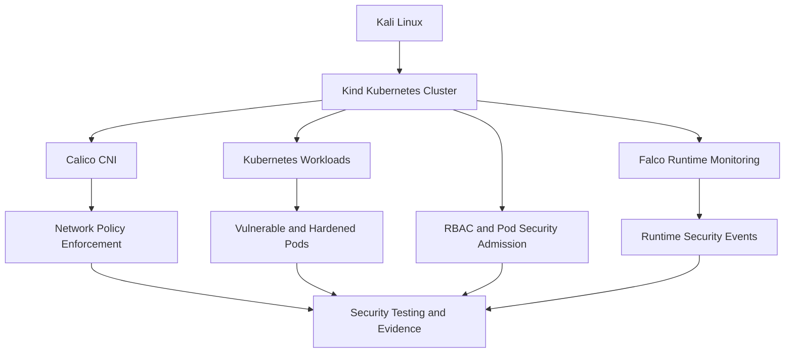

\# Kubernetes Security: Vulnerability Assessment and Hardening

A Kubernetes security project focused on identifying vulnerabilities, implementing security controls, hardening workloads, and monitoring runtime threats using Calico and Falco.

## Project Overview

This project demonstrates a practical approach to securing a Kubernetes cluster. It covers network isolation, Role-Based Access Control (RBAC), Pod Security Admission (PSA), workload hardening, and runtime threat detection.

The project uses a local Kubernetes cluster built with **Kind**, with **Calico** for network security and **Falco** for runtime threat detection.

## Project Objectives

- Build and configure a Kubernetes environment.
- Identify security weaknesses in Kubernetes workloads.
- Implement network segmentation using Calico NetworkPolicies.
- Configure RBAC using the principle of least privilege.
- Enforce Pod Security Admission restricted standards.
- Harden container workloads.
- Deploy Falco for runtime threat detection.
- Simulate security events and collect detection evidence.
- Document security testing results and recommendations.

## Technology Stack

| Technology | Purpose |
|---|---|
| Kali Linux | Development and testing environment |
| Kubernetes | Container orchestration |
| Kind | Local Kubernetes cluster |
| Calico | Container networking and NetworkPolicy enforcement |
| Falco | Runtime security monitoring |
| Docker / containerd | Container runtime |
| kubectl | Kubernetes cluster management |
| YAML | Kubernetes configuration |
| Linux shell | Security testing and automation |
| Git and GitHub | Version control and project hosting |

## Architecture



## Environment Configuration

| Component | Configuration |
|---|---|
| Operating System | Kali Linux |
| Cluster Platform | Kind |
| Kubernetes Server | v1.34.0 |
| Networking Plugin | Calico v3.33.0 |
| Runtime Security | Falco v0.45.2 |
| Container Runtime | containerd 2.1.3 |
| Cluster Name | calico-cluster |

## Project Milestones

### M1 – Environment Setup <span>Completed</span>

- Installed and configured the required Kubernetes tools.
- Created a local Kubernetes cluster using Kind.
- Verified cluster connectivity using kubectl.
- Configured the cluster environment for security testing.

### M2 – Kubernetes Network Security <span>Completed</span>

- Installed Calico as the Container Network Interface (CNI).
- Created a dedicated namespace for network testing.
- Configured NetworkPolicies to control pod-to-pod communication.
- Tested permitted and restricted network traffic.
- Verified that unauthorized workloads could not access protected services.

### M3 – Role-Based Access Control (RBAC) <span>Completed</span>

- Created Kubernetes ServiceAccounts.
- Configured Roles and RoleBindings.
- Implemented least-privilege access.
- Verified allowed and denied Kubernetes API operations.
- Tested restrictions on sensitive resources and workload creation.

### M4 – Vulnerability Assessment and Workload Hardening <span>Completed</span>

- Created vulnerable workload configurations for security assessment.
- Identified insecure container settings.
- Applied hardened Kubernetes configurations.
- Configured security contexts.
- Applied non-root execution, dropped Linux capabilities, disabled privilege escalation, and configured seccomp.
- Tested Pod Security Admission restricted enforcement.

### M5 – Falco Runtime Threat Detection <span>Completed</span>

- Deployed Falco in the Kubernetes cluster.
- Configured runtime monitoring.
- Created custom Falco rules.
- Detected shell execution inside containers.
- Detected package manager process execution inside containers.
- Collected runtime detection logs as evidence.

### M6 – Attack Simulation and Detection <span>Completed</span>

- Completed NetworkPolicy enforcement testing.
- Verified authorized and unauthorized pod communication.
- Tested restricted port access.
- Verified Falco shell execution detection.
- Verified Falco package manager process detection.
- Tested Pod Security Admission restricted enforcement.
- Verified RBAC least privilege permissions.
- Collected and committed security testing evidence.

### M7 – Security Assessment and Documentation <span>Completed</span>

- Consolidated security testing results from M1–M6.
- Analyzed vulnerabilities and mitigation effectiveness.
- Prepared the final Kubernetes security assessment report.
- Documented project limitations and future improvements.
- Committed the final assessment report to the repository.

Report: `reports/final-kubernetes-security-assessment.md`

### M8 – Final Demonstration and Submission <span>In Progress</span>

- Verified the Kubernetes cluster and security components.
- Demonstrated authorized and unauthorized NetworkPolicy traffic.
- Verified Falco shell execution detection.
- Verified Falco package manager process detection.
- Verified hardened workload security contexts.
- Verified Pod Security Admission and RBAC configurations.
- Organized and committed live demonstration evidence.
- Prepare the final project demonstration.
- Complete final academic submission documentation.

## Repository Structure

```text
k8s-security-fyp/
│
├── evidence/
│   ├── m6-falco/
│   │   ├── controlled-shell-detection.log
│   │   └── package-manager-detection.log
│   │
│   ├── m6-network/
│   │   └── network-policy-test-results.txt
│   │
│   ├── m6-security/
│   │   └── psa-rbac-hardening.txt
│   │
│   └── m8-demo/
│       ├── network-policy-live-demo.txt
│       ├── falco-runtime-live-demo.txt
│       └── workload-security-context-verification.txt
│
├── falco/
│   └── custom-rules.yaml
│
├── hardened/
│   ├── k8s-net-hardened-networking.yaml
│   ├── k8s-net-hardened-workloads.yaml
│   ├── least-privilege-rbac.yaml
│   ├── psa-secure-pod.yaml
│   └── secure-pod.yaml
│
├── reports/
│   └── final-kubernetes-security-assessment.md
│
├── vulnerable/
│   ├── insecure-pod.yaml
│   ├── overprivileged-rbac.yaml
│   ├── psa-privileged-pod.yaml
│   └── psa-restricted-test.yaml
│
├── kind-calico-config.yaml
├── kind-config.yaml
├── rbac-pod-reader.yaml
├── rbac-pod-reader-binding.yaml
├── .gitignore
└── README.md
```
## Security Testing and Evidence

### 1. NetworkPolicy Testing

Network communication was tested between authorized and unauthorized workloads.

| Test | Expected Result | Observed Result |
|---|---|---|
| Authorized client to server on TCP 8080 | Allowed | Successful |
| Unauthorized client to server on TCP 8080 | Blocked | Timed out |
| Authorized client to server on TCP 8081 | Blocked | Timed out |

Evidence:

`evidence/m6-network/network-policy-test-results.txt`

### 2. Falco Runtime Detection

Custom Falco rules were used to detect suspicious process execution inside containers.

Detection scenarios:

- Shell spawned inside a container.
- Package manager process executed inside a container.

Evidence:

- `evidence/m6-falco/controlled-shell-detection.log`
- `evidence/m6-falco/package-manager-detection.log`

**Testing note:** The BusyBox `dpkg --version` test returned an error because the BusyBox applet did not support that option. Falco nevertheless detected the `dpkg` process execution. This confirms process detection, not successful package installation or package management.

### 3. Pod Security Admission Testing

A privileged pod was tested against the restricted Pod Security Admission profile.

- The privileged test pod was rejected by the API server.
- The hardened pod successfully ran with restricted security settings.
- Security settings included non-root execution, disabled privilege escalation, dropped capabilities, read-only root filesystem, and RuntimeDefault seccomp.

### 4. RBAC Testing

The least-privilege ServiceAccount was tested.

| Permission | Result |
|---|---|
| List pods | Allowed |
| Get secrets | Denied |
| Create pods | Denied |

The overprivileged ClusterRoleBinding was confirmed absent.

Evidence:

`evidence/m6-security/psa-rbac-hardening.txt`

## Getting Started

### Prerequisites

Install and configure:

- Kali Linux
- Docker
- Kind
- kubectl
- Git

### Clone the Repository

```bash
git clone https://github.com/Softpaws-3104/k8s-security-fyp.git
cd k8s-security-fyp
```

### Create the Kind Cluster

Use the repository's Kind configuration:

```bash
kind create cluster --name calico-cluster --config kind-calico-config.yaml
```

### Install Calico

Follow the official Calico installation instructions:

https://docs.tigera.io/calico/latest/getting-started/kubernetes/kind

### Verify the Cluster

```bash
kubectl get nodes
kubectl get pods -A
kubectl get networkpolicies -A
kubectl get roles,rolebindings -A
kubectl get pods -n falco
```

**Note:** These commands describe the environment setup and inspection process. Apply project manifests according to their intended purpose. Do not apply vulnerable test manifests to a production cluster.

## Security Recommendations

- Apply least-privilege RBAC permissions.
- Avoid privileged containers unless strictly required.
- Run containers as non-root users.
- Disable privilege escalation.
- Drop unnecessary Linux capabilities.
- Enforce Pod Security Admission restricted policies.
- Use NetworkPolicies to restrict unnecessary communication.
- Monitor container activity using runtime security tools.
- Regularly review Kubernetes configuration and security logs.

## Future Scope

Potential improvements include:

- Automated security testing.
- Integration with centralized logging and alerting.
- Additional Falco detection rules.
- CI/CD security scanning.
- Automated vulnerability assessment.
- Integration with security monitoring platforms.
- Expanded attack simulation scenarios.

## Security Disclaimer

This project is intended for educational and authorized security testing purposes only. Vulnerable configurations and attack simulations should be used exclusively in controlled environments.

## Author

**Madhur Kanoje**

B.Tech Computer Science and Engineering

GitHub: [Softpaws-3104](https://github.com/Softpaws-3104)

Repository: [Kubernetes Security FYP](https://github.com/Softpaws-3104/k8s-security-fyp)

---

## Project Status

| Milestone | Status |
|---|---|
| M1 – Environment Setup | Completed |
| M2 – Network Security | Completed |
| M3 – RBAC | Completed |
| M4 – Vulnerability Assessment and Hardening | Completed |
| M5 – Falco Runtime Detection | Completed |
| M6 – Attack Simulation and Detection | Completed |
| M7 – Security Assessment and Documentation | Completed |
| M8 – Final Demonstration and Submission | In Progress |

**Current focus:** M8 – Final Demonstration and Submission.
